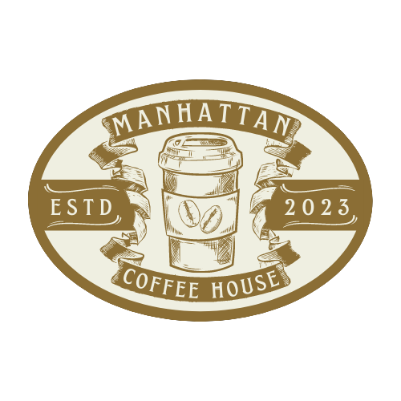

<div align="center">



# Manhattan Coffee

**Landing page de uma cafeteria fictícia, com efeito parallax, menu fixo e mapa de localização.**

[](https://mateusrosa0901.github.io/manhattan-coffee/)


</div>

---

<p align="center">
  
</p>

## ☕ O que tem no site

Uma página única, dividida em seções que o menu do topo leva direto:

- **Início** — chamada principal da cafeteria
- **Informações** — o que é o café Manhattan e o café gourmet da casa
- **Contatos & Endereço** — endereço com **mapa do Google Maps incorporado**
- **Horários** — funcionamento de segunda a domingo
- Botão de **voltar ao topo**

## 🛠️ O que pratiquei

- **Efeito parallax** só com CSS (`background-attachment: fixed`), em quatro seções com imagens diferentes
- **Menu fixo** no topo (`position: fixed`) com links âncora para cada seção
- **Flexbox** para alinhar o conteúdo
- Incorporar um mapa com `<iframe>`

## 📁 Estrutura

```
├── index.html   # a página inteira
├── style.css    # todo o estilo, incluindo o parallax
└── img/         # logo, imagens de fundo e ícones
```

## ▶️ Como abrir

Acesse a [versão online](https://mateusrosa0901.github.io/manhattan-coffee/) ou clone o repositório e abra o `index.html` no navegador:

```bash
git clone https://github.com/mateusrosa0901/manhattan-coffee.git
```

---

<p align="center">Feito por <a href="https://github.com/mateusrosa0901">Mateus Rosa</a></p>
